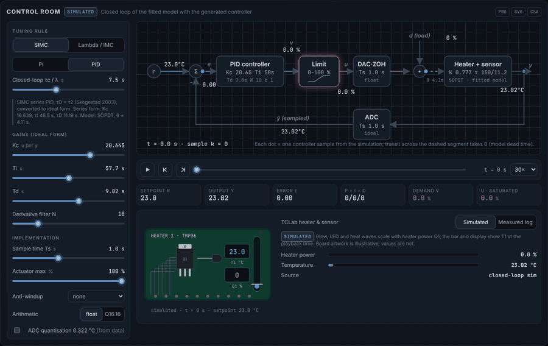

# Engineering Tools

Three engineering tools by **Akash Shah**, MEng Mechatronics and Robotics, University of Sheffield.
Each one runs in the browser or from a single command, is checked against published or measured data where available, and labels every value as measured, simulated or synthetic.

| Tool | What it does | Area |
|---|---|---|
| [**LoopForge**](loopforge/) | Fits FOPDT/SOPDT models to a measured TCLab heater step test, tunes PI/PID controllers (SIMC, lambda/IMC), simulates saturation and anti-windup, shows Bode, Nyquist and margins, and exports C99 controller code. | Control systems |
| [**ActiveRide**](activeride/) | MuJoCo full-vehicle simulation on measured road profiles comparing passive, skyhook, LQR with Kalman filter and preview LQR suspension control, with a 3D replay viewer. | Vehicle dynamics, optimal control |
| [**CANProof**](canproof/) | Parses DBC files and computes CAN bus load and worst-case response times using the revised analysis of Davis et al. (2007), with a 3D bus visualisation. | Embedded, automotive networks |

## Running them

- **LoopForge:** open `loopforge/index.html` in a browser. No install needed.
- **CANProof:** open `canproof/index.html` in a browser. No install needed.
- **ActiveRide:** open `activeride/viewer/index.html` for the 3D viewer, or run `python run_all.py` in `activeride/` to rebuild every result.

See each folder's README for methods, data sources, validation and limitations.
