# ActiveRide

**A 3D simulation study of active-suspension control on measured road profiles.** A MuJoCo
full-vehicle plant drives over profilometer-measured motorway wheel paths and labelled synthetic
obstacles. Four control strategies are compared: passive, skyhook, LQR with a Kalman filter, and
preview LQR. The controllers are designed on a separate analytical 7-DOF model, and every result
comes with the validation behind it.

> **Simulation only.** None of these controllers was tested on a real car. All motion, forces and
> comfort numbers come from the simulated plant. Road heights are either **MEASURED** (LiRA-CD) or
> **SYNTHETIC** (analytic shapes), and both are labelled wherever they appear.

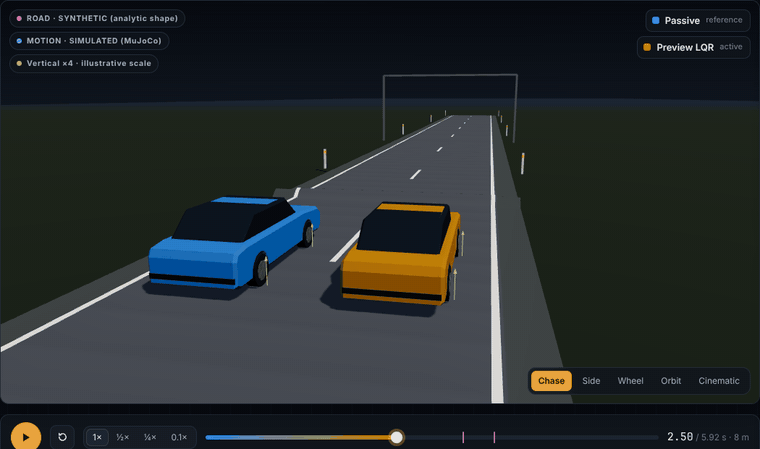

| Measured motorway, roughness heat map | Wheel close-up, X-ray, force & tyre-load arrows |
|---|---|
| 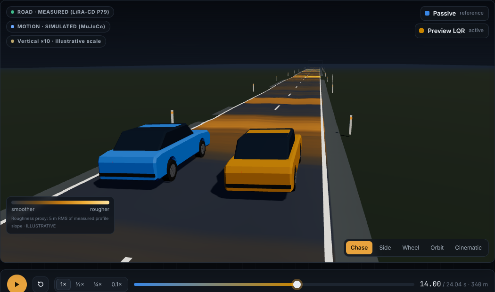 | 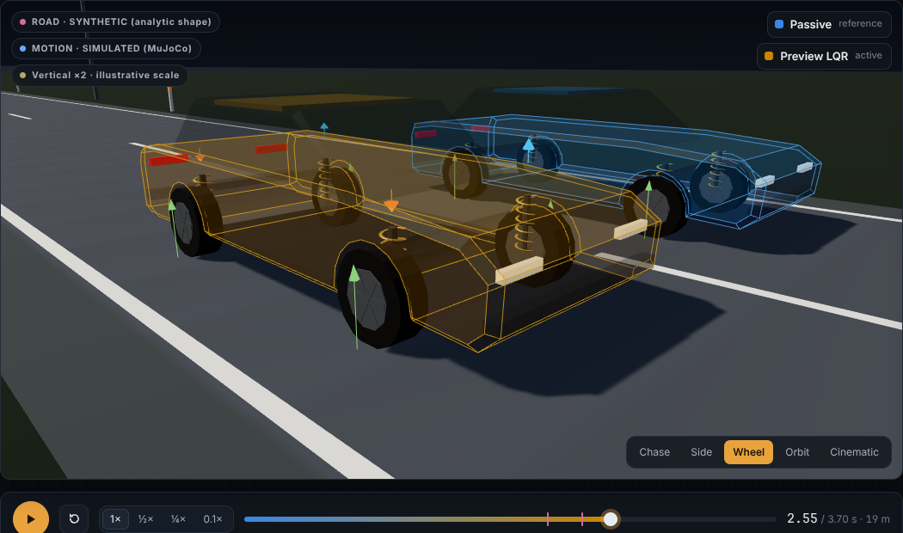 |

<details><summary>Full dashboard (dark/light) and phone layout</summary>

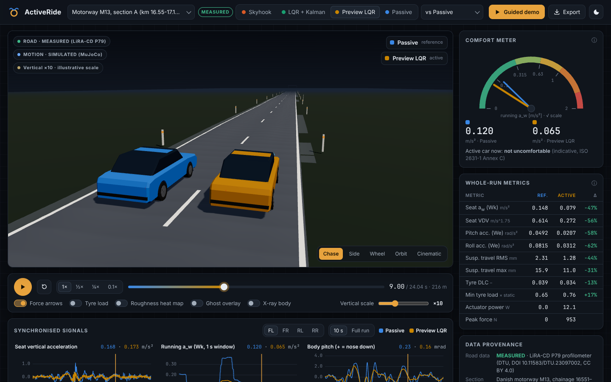
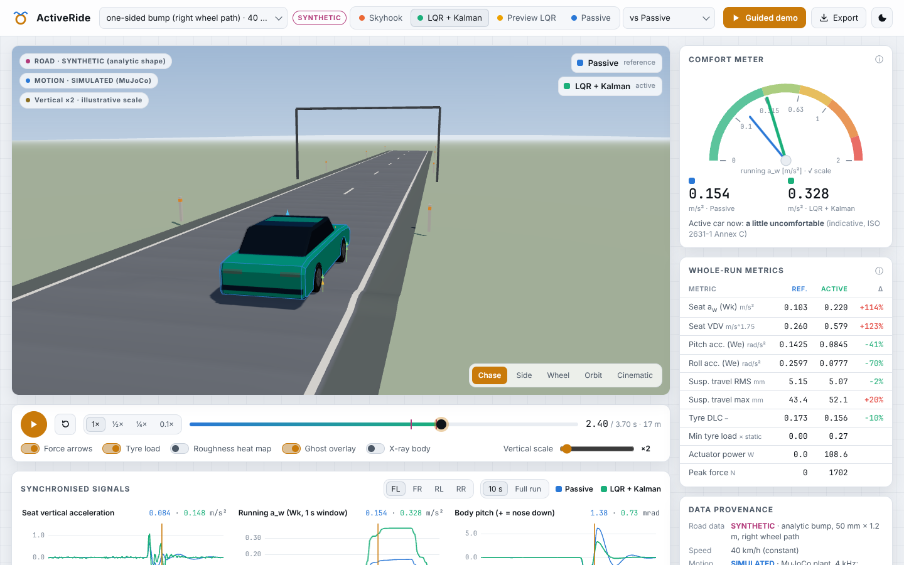
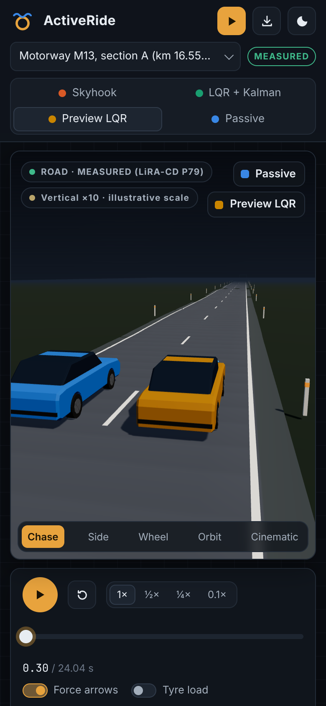
</details>

---

## Quick start

```bash
pip install mujoco numpy scipy matplotlib imageio imageio-ffmpeg pillow pytest
```

```bash
python run_all.py
```

```bash
python -m pytest -q tests
```

* `run_all.py` runs the whole pipeline in about 4 minutes on 4 cores: fetch and verify data,
  validation, 6 scenarios × 4 controllers, the Monte Carlo study (60 plants × 4 controllers), the
  preview-sensor study, figures, and the viewer data. Add `--videos` to also render the MP4s, which
  needs an OpenGL context; on a headless machine run it under `xvfb-run -a`.
* `python run_all.py --figures-only` rebuilds the figures and viewer data from saved results.
* **Viewer:** open `viewer/index.html` directly in a browser. It works offline from `file://`,
  because the libraries are vendored and the data is embedded in `viewer/data/activeride_data.js`.
  For GitHub Pages, publish the `activeride/viewer/` folder as is.

### Using the viewer

The viewer opens on the measured M13 section, passive (blue) against preview LQR (amber), and
starts playing.

* **Guided demo** (button or `D`): six narrated steps covering the measured road, the roughness
  heat map, a slow-motion speed bump, a pothole wheel close-up, the one-sided-bump trade-off and
  the ghost overlay.
* **Active car** switch: Skyhook / LQR + Kalman / Preview LQR / Passive (keys `1`–`4`).
  **vs**: the reference car.
* **Cameras:** Chase, Side, Wheel close-up (switches on X-ray), Orbit (drag), Cinematic
  auto-cut (`C` cycles).
* **Playback:** play/pause (`Space`), 1×, ½×, ¼× and 0.1×, scrub the timeline (obstacle
  markers show when each axle hits), and `←`/`→` to step.
* **Toggles:** actuator force arrows, tyre-load arrows, roughness heat map (`H`, measured
  roads only), ghost overlay (`G`), X-ray body, and vertical exaggeration ×1–×30. The
  exaggeration is clearly labelled: measured roughness and body motion are millimetres and
  would be invisible at true scale.
* **Comfort meter:** running 1 s Wk-weighted seat acceleration for both cars, against the
  indicative ISO 2631-1 Annex C bands.
* **Synchronised plots:** nine linked panels. Hover for values (the crosshair is linked across
  panels), click or drag to seek, and pick the corner (FL/FR/RL/RR) and the window (10 s or full
  run). Hovering a car in 3D shows that corner's stroke, tyre load and actuator force.
* **Export:** 3D view PNG, plots PNG, plots SVG, run data CSV, metrics CSV.

### Videos (MuJoCo offscreen rendering)

`videos/` holds side-by-side MP4s with a chase camera and an overlaid live seat-acceleration plot,
at true vertical scale:
[measured M13 A: passive vs preview](videos/m13_A_passive_vs_preview.mp4) ·
[speed bump: passive vs preview](videos/speed_bump_passive_vs_preview.mp4) ·
[one-sided bump: passive vs LQR](videos/one_sided_bump_passive_vs_lqr.mp4).
Re-render with `xvfb-run -a python scripts/render_videos.py`.

---

## Method

### Plant (MuJoCo, `activeride/plants.py`)
A rigid body (1400 kg; heave, pitch and roll joints at the CG; a forward slide held at constant
speed) carries four wheel bodies on **body-fixed vertical slide joints**. Suspension springs and
dampers are the joint stiffness and damping, and the actuators are motors on the same joints.
Each **tyre is a vertical spring-damper to the road surface**, evaluated at the wheel's world
x-position every 0.25 ms. It is unilateral, so the wheel can lift off. The model is generated as
MJCF from the config, with an original low-poly car (body, cabin, 14-sided wheels with spokes,
visible strut tendons). MuJoCo keeps the exact 3D geometry: finite rotations, suspension axes
that tilt with the body, and wheel masses that move with the body.

### Design model (analytical 7-DOF, `activeride/model7dof.py`)
`M q̈ + C q̇ + K q = Sᵀu + B_z z_r + B_ż ż_r` with `q = [z_s, θ, φ, z_u1..4]`. For control it is
augmented to 22 states: the road at each wheel follows a shaping filter
`ż_r = −α z_r + w` (α = 2π·0.05 rad/s), and each actuator is a first-order lag at its
bandwidth.

### Actuators and sensors (identical for all active controllers)
* Actuator (per corner): ±2.5 kN saturation, then a 12 Hz first-order force loop, then a
  60 kN/s slew-rate limit. It acts in parallel with the passive damper.
* Sensors, with white noise: 4 body-corner accelerometers (0.05 m/s²), pitch and roll gyros
  (0.003 rad/s), 4 stroke sensors (0.5 mm) and 4 actuator force sensors (20 N). No controller
  sees the true state.

### Controllers (`activeride/controllers.py`)
| | Law |
|---|---|
| Passive | actuators removed |
| Skyhook | `u_i = −c_sky·ẑ_ci`, absolute corner velocity from the Kalman filter, c_sky = 4 kN·s/m |
| LQR + Kalman | discrete LQR (1 kHz) on the 22-state model. Cost: heave, pitch and roll acceleration, stroke, tyre deflection and force. Steady-state Kalman filter |
| Preview LQR | the same LQR plus optimal feed-forward `u_ff = −Σ_j (R+BᵀPB)⁻¹Bᵀ(A_cᵀ)ʲ P E w_{k+j}` from a look-ahead sensor with **6 m range**, 2 mm noise and 1 m smoothing. The road height at the wheel is also fused into the Kalman filter |

### Metrics (`activeride/metrics.py`)
* ISO 2631-1 **Wk**-weighted seat acceleration a_w (RMS) and VDV. The seat point is 0.10 m ahead of
  and 0.38 m left of the CG.
* **We**-weighted pitch and roll acceleration; pitch and roll angle RMS.
* Suspension travel RMS and max; tyre dynamic load coefficient (DLC) and minimum load/static
  ratio; mean positive actuator power (no regeneration credited); peak force.

The weightings use the Annex A analogue filter definitions, applied exactly in the frequency
domain. This is an engineering implementation, not a certified ISO instrument.

---

## Validation (`activeride/validation.py`, `tests/`, `results/validation.json`)

All 11 tests pass (`python -m pytest -q tests`, about 20 s).

| Check | Result |
|---|---|
| Static equilibrium (MuJoCo, flat road) | drift 0.4 µm; tyre loads match the analytical axle split to 0.3 mN; 20 mm offset decays to <1 µm |
| Natural frequencies, **geometry-matched** MuJoCo vs 7-DOF (undamped) | max error **0.016 %** (heave 1.34, pitch 1.49, roll 1.83, wheel hop 13.3–13.9 Hz) |
| Natural frequencies, **realistic geometry** | wheel hop within 0.01 %; heave −0.1 %, pitch −1.0 %, **roll −4.0 %** (see disagreements) |
| Frequency response, one-wheel sine dwell, 0.8–13 Hz | heave within 0.5 %; worst channel (roll) 6.5 % |
| MuJoCo vs 7-DOF on measured road A (normalised RMS difference) | heave 0.05 %, pitch 2.7 %, roll 6.3 %, stroke 6.1 %, seat acc. 2.9 % (passive) |
| Riccati residuals | LQR DARE 9e-13 and Kalman DARE 4e-14 (relative); closed loops stable (spectral radius < 1) |
| Preview law vs brute-force batch LQ optimum | max relative difference 7e-12 |
| Energy: undamped | secular drift 0.01 %; bounded integrator oscillation 2.0 % → 0.2 % at h/10 (O(h), as expected) |
| Energy: damped balance | E(0) − E(t) equals the damper dissipation within 0.15 %; energy decreases monotonically |
| Signs | u > 0 lifts the body (static heave matches to 0.006 %) without moving the wheels; front lift gives nose-up; left lift gives positive roll; accelerometers read 0 at rest |
| ISO 2631-1 Wk vs Table 3 | within 0.1 % at 10 tabulated frequencies |
| Kalman estimates vs MuJoCo truth (measured road) | correlation ≥ 0.998 for heave, pitch and roll rate and for stroke |

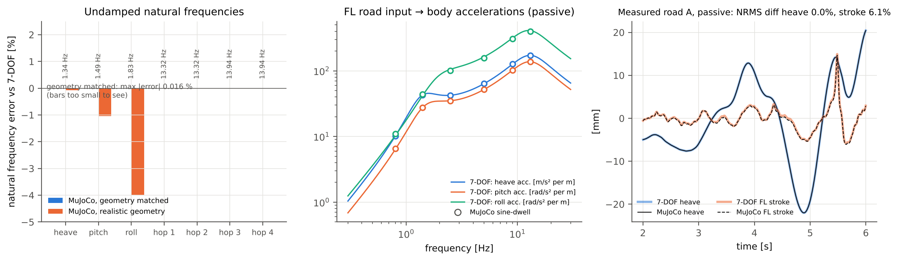

### Where the models disagree
* **Roll −4 % and pitch −1 % in MuJoCo against the 7-DOF model.** The MuJoCo wheel masses sit
  0.25 m below the roll and pitch axis and move with the body, and the static tyre preload acts at
  that offset, which adds a destabilising geometric-stiffness term. The textbook 7-DOF model omits
  both. Moving the wheels to CG height and removing their rotary inertia makes the difference
  vanish (0.016 %), so this is a modelling difference, not a bug. It reaches the time-domain
  comparison as about 6 % normalised RMS in roll and stroke.
* **Measured data:** there was no measured suspension response to compare against (Warwick was blocked; see below).
  The plant has therefore been checked against analytical physics only, not against a real vehicle.

---

## Results (MuJoCo plant; `results/results_table.md`, `results/metrics.csv`)

Seat a_w (Wk, m/s²) and change against passive:

| Scenario | Passive | Skyhook | LQR + Kalman | Preview LQR |
|---|---|---|---|---|
| M13 A, 90 km/h (MEASURED) | 0.148 | 0.140 (−5 %) | 0.093 (−37 %) | **0.079 (−47 %)** |
| M13 C, 90 km/h (MEASURED) | 0.117 | 0.090 (−23 %) | 0.071 (−40 %) | **0.065 (−44 %)** |
| M13 B, 60 km/h (MEASURED) | 0.066 | 0.065 (−1 %) | **0.047 (−29 %)** | 0.052 (−21 %) |
| Speed bump 70 mm, 25 km/h (SYNTHETIC) | 0.93 | 0.96 (+4 %) | 0.62 (−33 %) | **0.60 (−36 %)** |
| Pothole −40 mm, left, 40 km/h (SYNTHETIC) | 0.72 | 0.77 (+8 %) | 0.64 (−10 %) | **0.61 (−15 %)** |
| One-sided bump 50 mm, right, 40 km/h (SYNTHETIC) | **0.10** | 0.20 (+98 %) | 0.22 (+114 %) | 0.17 (+62 %) |

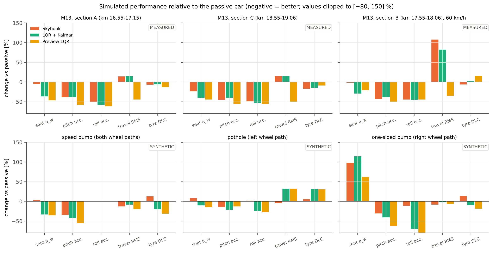

Observations, all from simulation:
* On the measured motorway, LQR + Kalman and preview LQR reduce seat a_w by 29–47 % and
  pitch and roll acceleration by 39–62 %, with about 2–12 W of mean actuator power. Absolute
  comfort values are small because the road is ISO 8608 class A (IRI ≈ 0.7–1.2 m/km).
* **Preview helps only with good look-ahead data.** Perfect preview would give a_w 0.064 on A,
  against 0.095 for LQR (15 s runs, `fig7`). With 2 mm noise the benefit shrinks; at 60 km/h,
  preview does worse than plain LQR; with 6 mm noise preview is worse than LQR on both roads. The
  1 m smoothing in the default config was chosen in this sweep. That is a tuning choice on the
  same data, so the preview numbers are mildly optimistic.
* **Actuator limits matter on obstacles.** With unlimited force, preview LQR would cut speed-bump
  a_w to about 0.20 (an exploratory run, not in the tables); with ±2.5 kN it saturates and
  reaches only 0.60.
* **Trade-offs:** skyhook and LQR increase suspension travel by 15–108 % on the measured roads.
  On the pothole, LQR and preview raise tyre DLC by about 30 %. Skyhook makes sharp obstacles
  slightly worse.
* **One-sided bump:** the active controllers cut roll acceleration by 70–80 %, yet seat a_w
  roughly doubles. The seat is on the side away from the bump, where the passive car's roll and
  heave partly cancel. The controllers trade this seat-point cancellation for less body roll,
  which shows that the LQR cost (CG accelerations) is not the seat metric.
* **Robustness (Monte Carlo, 60 plants):** mass ±10 %, springs ±10 %, dampers ±15 %, tyres
  ±10 % and sensor noise ×1–3, with the controllers designed on the nominal car; 12 s of road A.
  All runs stayed stable, and every active controller beat passive on seat a_w in 60 of 60
  samples. Median a_w ratio against passive: LQR 0.62 (worst 0.67), preview 0.71 (worst 0.98),
  skyhook 0.92. Preview degrades mostly with sensor noise (`fig6`), and preview raised tyre DLC
  (median 0.050 against 0.040 passive).

| | |
|---|---|
| 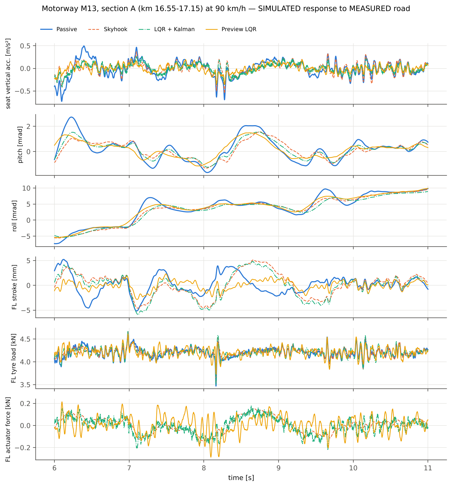 | 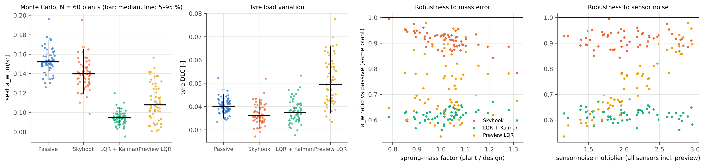 |
| 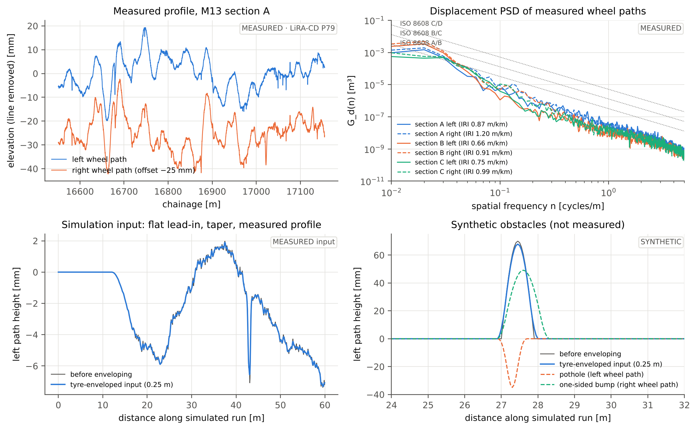 | 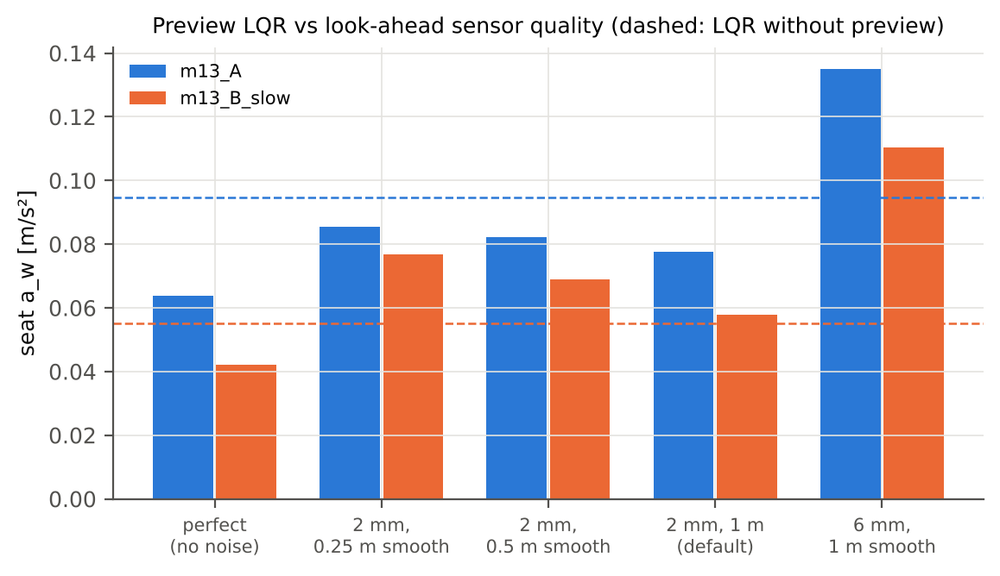 |

All figures are in `figures/` as PNG (200 dpi) and PDF.

---

## Data

See **[data/README.md](data/README.md)** for each source's URL, DOI, licence, access date,
checksums and preprocessing. In short:

* **LTPP InfoPave (requested main source): blocked.** The build environment's network policy
  refused the host, and InfoPave profile export is interactive anyway. **No LTPP data were used.**
* **Measured road actually used:** LiRA-CD P79 profilometer, left and right wheel paths, Danish
  motorway M13 (DTU, DOI 10.11583/DTU.23097002, CC BY 4.0). The original figshare host was also
  blocked, so verified original-byte excerpts were taken from a public GitHub mirror. Three
  sections (about 1.6 km in total) are committed as small CSV samples.
* **Warwick suspension benchmark (DOI 10.5281/zenodo.17242919): blocked. No comparison against
  measured displacement was made.** The comparison code is in place (`activeride/warwick.py`),
  but it is untested.

## Assumptions and limitations

* Every vehicle, actuator and sensor parameter in `config/activeride.toml` is an assumption for a
  generic mid-size car, not an identified vehicle. There are no anti-roll bars, bump stops or
  suspension kinematics (pure vertical slides), and the dampers are linear.
* The tyres are point-contact vertical spring-dampers, with a 0.25 m moving-average envelope on
  the road. There is no lateral or longitudinal tyre force, and the car runs at constant speed in a
  straight line.
* Each lane's left and right wheel paths come from the same P79 run, so both cars experience
  identical inputs. The viewer shows the same profile in both lanes.
* The look-ahead sensor model observes each road point once with white noise. Real sensors have
  correlated errors, latency and vehicle-motion compensation issues, which are not modelled.
* The 1 s running a_w and the Annex C bands in the viewer are indicative. ISO 2631 assessments use
  whole-exposure values.
* The LQR weights and the preview smoothing were tuned on the same measured data that is
  reported (small sweeps, documented in `config/activeride.toml` and `fig7`). There is no held-out
  road.
* Validation is against analytical models and physical invariants only. **The plant was not
  validated against measured vehicle or rig data**, because the planned Warwick comparison could
  not be run.

## Repository layout

```
activeride/            Python package: config, road, model7dof, plants (MuJoCo + linear), controllers,
                       sim, metrics, validation, experiments, figures, warwick
config/activeride.toml every parameter, labelled as an assumption
data/                  README (provenance), samples/ (committed measured excerpts + SHA256SUMS), fetch_log.json
scripts/               fetch_data.py, render_videos.py, build_vendor.sh
tests/                 validation suite (pytest)
results/               metrics.csv, results_table.md, validation.json, montecarlo*.json, preview_sensitivity.json
figures/               publication figures (PNG + PDF)
videos/                MuJoCo offscreen MP4s
viewer/                self-contained three.js replay viewer (index.html, css, js, vendor/, data/)
docs/                  README screenshots and GIF
run_all.py             reproduce everything
```

## Licences

Code: as in the parent repository. Vendored three.js 0.160.0: MIT (`viewer/vendor/three.LICENSE`).
LiRA-CD samples: CC BY 4.0, © the dataset authors (see `data/README.md`).
