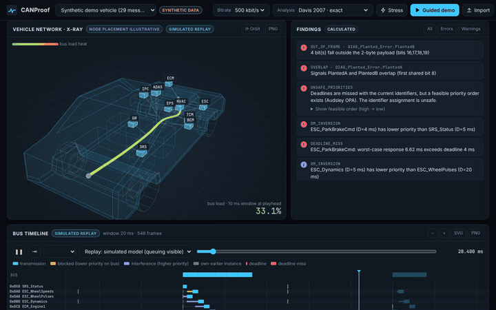
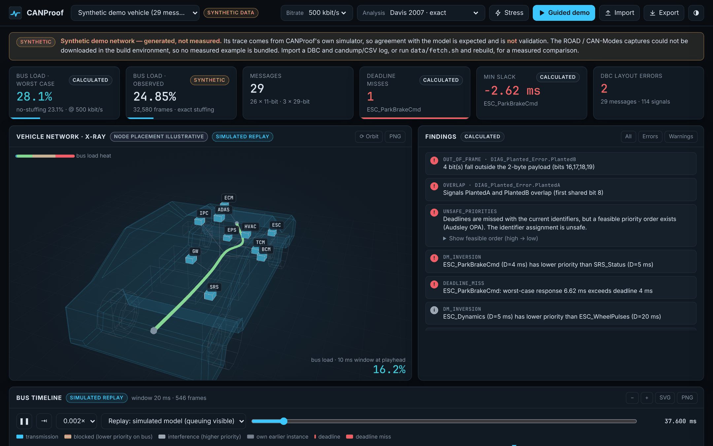
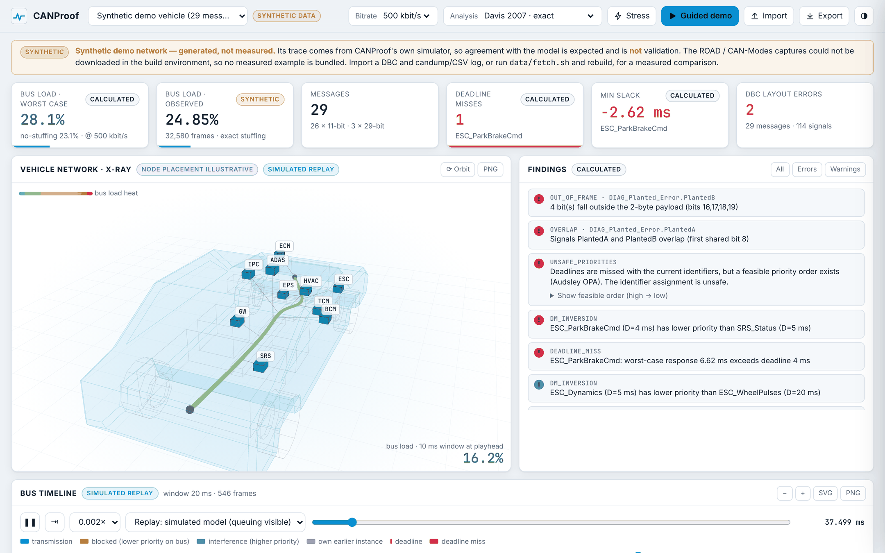
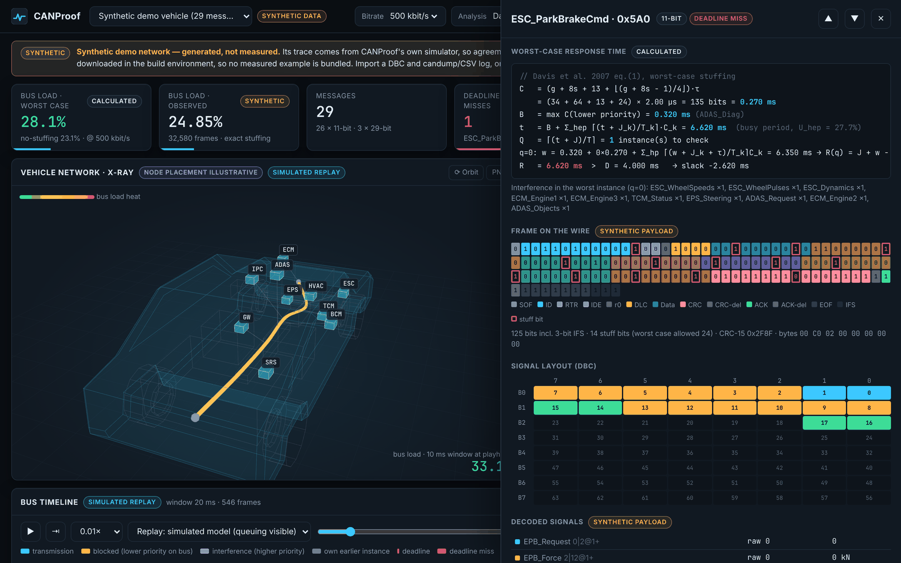
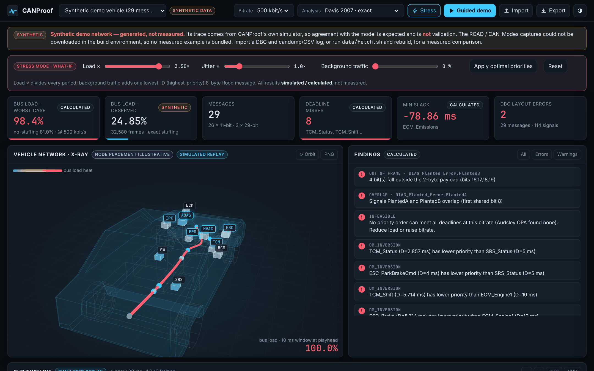
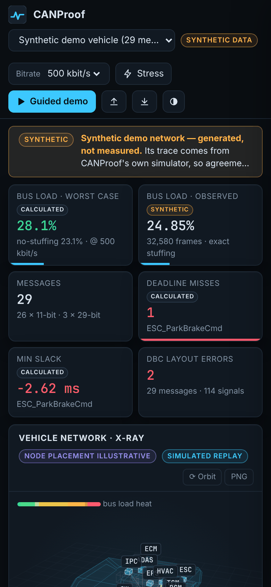

# CANProof

CANProof checks CAN bus timing at design stage, in the browser. It is **one self-contained HTML file** (`index.html`, about 2 MB, works offline, ready for GitHub Pages). It parses DBC files, calculates bus load and worst-case response times with the **revised analysis of Davis, Burns, Bril & Lukkien (2007)**, flags missed deadlines, unsafe priorities and DBC layout errors, and compares the model against logged traffic.



> **Read this first: data status.** The requested real datasets (ROAD ambient captures and CAN-Modes) **could not be downloaded**: the build environment's network policy denied their hosts. So **no measured data is bundled and no validation against real data has been done.** The example that loads automatically is a **clearly labelled synthetic network**, and its trace comes from CANProof's own simulator. The page, the CLI and the fetch script are ready for the real data. See [`data/README.md`](data/README.md).

## Quick start

* Open `index.html` in a browser, or serve this folder with GitHub Pages. No build step and no network needed.
* **Guided demo**: click *▶ Guided demo* for an 8-step tour.
* **Your data**: *Import* (or drag and drop) a `.dbc` and/or a CAN log: candump `(ts) can0 123#DEADBEEF`, candump `-ta` style, or CSV `timestamp,id,dlc,data`. The bitrate is inferred from the log when possible.
* **Published example**: choose *Published example — Davis et al. 2007* from the dataset menu. Then switch *Analysis* to *Original (Tindell)* to see the optimistic result that paper refuted.
* URL options for scripted views: `?example=davis2007`, `?select=<MessageName>`, `?stress=2.5`, `?t=<ms>`, `?speed=0.01`, `?paused=1`, `?tour=1`.

```bash
npm test                  # core unit/property tests (Node ≥ 18, no dependencies)
node tests/ui.e2e.js      # headless browser end-to-end test (Playwright + Chromium)
node tools/build.js       # rebuild index.html from src/, vendor/ and data/
```

## What it does

| Area | Details |
|---|---|
| DBC parsing | `BU_`, `BO_`, `SG_` (Intel/Motorola, signed, multiplexed), `CM_`, `VAL_`, `BA_DEF_`/`BA_DEF_DEF_`/`BA_`. Cycle time comes from `GenMsgCycleTime` (or `CycleTime`). Optional deadline and jitter attributes are `GenMsgDeadline` and `GenMsgJitter`. Bit 31 marks a 29-bit ID. |
| Editing | Period T, deadline D and jitter J are editable in the table. Bitrate and analysis method are selectable. Priorities change by swapping identifiers (▲/▼ in the drawer) or with *Apply optimal priorities*. Edited timing exports as DBC attributes. |
| Frame timing | Worst-case stuffing per Davis et al. eq. (1): `C = g + 8s + 13 + ⌊(g + 8s − 1)/4⌋` bits, g = 34 (11-bit) / 54 (29-bit), so 135 / 160 bits for 8 bytes. Logged frames are rebuilt bit by bit (CRC-15 plus stuffing) for exact lengths. |
| Bus load | Worst case and no-stuffing from the model. Observed load uses exact per-frame stuffing, both averaged and in 100 ms windows. |
| WCRT | Revised analysis: blocking `B_m = max_lp C_k`; level-m busy period `t_m`; `Q_m = ⌈(t_m+J_m)/T_m⌉` instances; `w_m(q) = B_m + qC_m + Σ_hp ⌈(w+J_k+τ_bit)/T_k⌉C_k`; `R_m = max_q (J_m + w_m(q) − qT_m + C_m)`. Also included: the sufficient test (eq. 16), and the **original Tindell analysis for comparison only** (the UI marks it unsafe). Times are integer nanoseconds, so the ceilings are exact. A busy period that diverges is reported as ∞. Mixed 11/29-bit arbitration is handled: the base ID is compared first, then standard beats extended. |
| Findings | Deadline misses; low slack; deadline-monotonic inversions; **unsafe priorities** (misses that an Audsley optimal priority assignment would fix) and **infeasible** sets; DBC layout errors: overlapping signals (mux-aware), bits outside the payload, duplicate IDs and signals, 11-bit range, Motorola start-bit errors, value range larger than the bit width allows, undeclared senders, DLC > 8 (CAN FD not supported). |
| Visuals | 3D low-poly x-ray car with original, unbranded systems, ECU nodes and the CAN bus (three.js). Replayed frames travel as pulses from the sender along the bus, and the bus colour is the load in a 10 ms window. A linked timeline shows release, blocking, interference, transmission, deadline ticks and misses. Also: response-vs-deadline chart, load chart and data-vs-model chart, with linked hover and click everywhere. |
| Proof drawer | Click any message: step-by-step WCRT derivation (C, B, busy period, every q), the frame bits on the wire with stuff bits marked, the DBC signal layout grid, decoded signal values, and trace statistics. |
| Stress mode | Load × (divides every period), jitter ×, background flood traffic, and optimal priorities. Deadline misses appear live in every view. |
| Export | CSV (results, trace measurements, comparison), SVG/PNG (charts, timeline), PNG (3D), DBC (edited timing). |
| Labels | Every panel is tagged **measured**, **synthetic**, **simulated**, **calculated**, **illustrative** or **assumed**. The 3D node placement is always labelled illustrative, because a DBC holds no physical location. |

Screenshots (headless Chromium, 1440 × 900 and 390 × 844):

| Dark (default) | Light |
|---|---|
|  |  |
| **Proof drawer** | **Stress ×3.5** |
|  |  |



## Method

### Response-time analysis
This follows R.I. Davis, A. Burns, R.J. Bril, J.J. Lukkien, *Controller Area Network (CAN) schedulability analysis: Refuted, revisited and revised*, Real-Time Systems 35(3):239–272, 2007, DOI [10.1007/s11241-007-9012-7](https://doi.org/10.1007/s11241-007-9012-7). The busy-period and multi-instance formulation is used, because a busy period can hold several instances of a message, and the original single-instance analysis then becomes optimistic (Davis et al. 2007, Sect. 3). The exact equations are in `src/core.js` (`analyse`) and the page's *Method* section.

It assumes: an error-free bus (no error model), every node keeps its transmit queue in priority order with no transmit-buffer inversion or abort delays, release jitter J is given, and the deadline D is relative to the nominal release. Audsley's OPA (`optimalPriorityAssignment`) is valid here because `R_m` depends only on the *sets* of higher- and lower-priority messages.

### Trace measurement (from a single bus tap)
* **Period**: frames are indexed on a periodic grid step by step (robust to drops and drift), then fitted by least squares.
* **Arrival spread ("jitter")**: max − min residual of the arrival times around that grid. It includes release jitter, queuing variation and clock drift, so it is an upper bound on any single one of them.
* **Payload length**: DLC min/max/mode for each ID.
* **Bitrate inference**: the 0.2nd percentile of `Δt / frame_bits` over consecutive frames, snapped to a standard rate.
* **Comparison**: for each ID, the model says the spread must not exceed `R_m − C_m,min`. A larger observed spread is a **disagreement**, which the UI and CLI report rather than hide.
* **Deadlines are assumed** (`D = T`) whenever the data does not give them, and every view marks them as assumed.

## Validation

### Done and passing
| Check | Result |
|---|---|
| **Published example, Davis et al. 2007** (`tests/core.test.js`): 3 messages, C = 1 ms (125 bits at 125 kbit/s), T = 2.5/3.5/3.5 ms, D = 2.5/3.25/3.25 ms | Revised analysis: R = 2.0 / 3.0 / **3.5 ms**, so C misses its deadline. Busy period 7 ms, Q = 2, and the worst case is the 2nd instance. The original analysis gives **3.0 ms** (the published flaw). A discrete-event simulation of the synchronous release reproduces 3.5 ms. ✔ |
| Frame-length formula | 55 + 10s bits (11-bit), 160 bits for 8-byte 29-bit. The exact stuffing of 20,000 random frames always falls between the no-stuffing and worst-case bounds. ✔ |
| Simulation ≤ analysis | 40 random message sets × 4 jitter modes × 2 s simulated: no simulated response ever exceeds the analytic bound. ✔ On the demo network with random phasing, simulated maxima reach 54–100% of the bound (median 90%), and exactly 100% for the lowest-priority message. |
| Sufficient test ≥ exact test | ✔ |
| **Decoder vs cantools 45.1.2** (independent, PyPI) | 33,600 decoded values (300 random payloads × every signal of the demo DBC, including Motorola and signed): **0 mismatches** (`tools/crosscheck_cantools.{py,js}`). cantools refused the planted faulty message; CANProof flags it as a layout error. ✔ |
| Synthetic ground-truth pipeline | The measured periods match the DBC within 1%, 500 kbit/s is inferred correctly, and the observed load (24.85%) falls inside the predicted range (23.1–28.1%). The J = 0 model **disagrees for exactly 3 IDs, all of which have injected jitter**, and for none once J = measured. ✔ |
| UI end-to-end (`tests/ui.e2e.js`, offline headless Chromium) | Auto-load, table editing, stress (×3.5 → 8 misses), reset, method switch, Davis example in the UI, DBC+log import, drawer, all 10 exports, full tour, theme. No page errors, no network requests, no horizontal scroll at 1440 px or 390 px. ✔ |

### Not done
* **No validation against real data.** The ROAD and CAN-Modes downloads were blocked (see `data/README.md`), so I can't say where the model disagrees with *measured* traffic. The only disagreements reported so far are the 3 synthetic IDs with deliberately injected jitter.
* **pyCPA cross-check not run.** `tools/crosscheck_pycpa.py` compares the WCRTs against pyCPA's SPNP scheduler (MIT, TU Braunschweig). The repository was cloned, but executing third-party code was not permitted in the build session. Run it yourself with the commands in the script header.
* **The Davis 2007 paper could not be re-fetched** (publisher and author pages blocked). The example's parameters and the 3.0 ms versus 3.5 ms result are the paper's well-known motivating example, entered from memory and checked independently by the simulation test. Please check them against the paper.

## Limitations
* Classical CAN only: no CAN FD frames or bit-rate switching, and DLC > 8 is flagged.
* No error-frame or retransmission model, so the response times assume an error-free bus.
* No gateway or multi-bus end-to-end latency, no FIFO transmit queues, no transmit-abort effects.
* A single tap cannot separate release jitter from queuing delay. The data-vs-model check is therefore a consistency test, not a measurement of response time.
* Bitrate inference needs bursts of back-to-back frames and µs timestamps.
* The 3D vehicle and ECU positions are illustrative. Pulse travel speed is slowed for visibility, while emission times, senders, receivers, miss flashes and the heat colour come from the replayed frames.
* With large DBCs (hundreds of messages) the timeline rows get thin, and the OPA check scales as O(n³) analyses.

## Layout
```
canproof/
  index.html            built single-file app (GitHub Pages)
  src/                  core.js (analysis, UMD, Node-testable) · charts.js · car3d.js · app.js · ui.html · ui.css
  vendor/               three.js r158 (MIT) + licence + SHA256SUMS
  tools/                build.js · make_synthetic.js · analyse_trace.js · capture_docs.js · ui_check.js · cross-check scripts
  tests/                core.test.js (node:test) · ui.e2e.js (Playwright)
  data/                 README.md · fetch.sh · synthetic/ (labelled synthetic) · samples/ (measured excerpts, empty)
  docs/                 screenshots + GIF
```

## Licences
CANProof is MIT (see `LICENSE`). It bundles three.js r158 (MIT, © 2010–2023 three.js authors), with its licence kept in `vendor/three-LICENSE.txt` and inline in `index.html`. The synthetic data is original, CC0-style: use it freely. No third-party data is committed.
