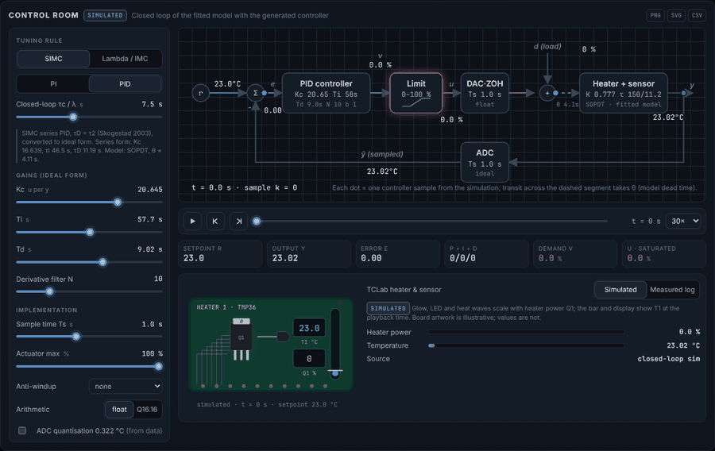
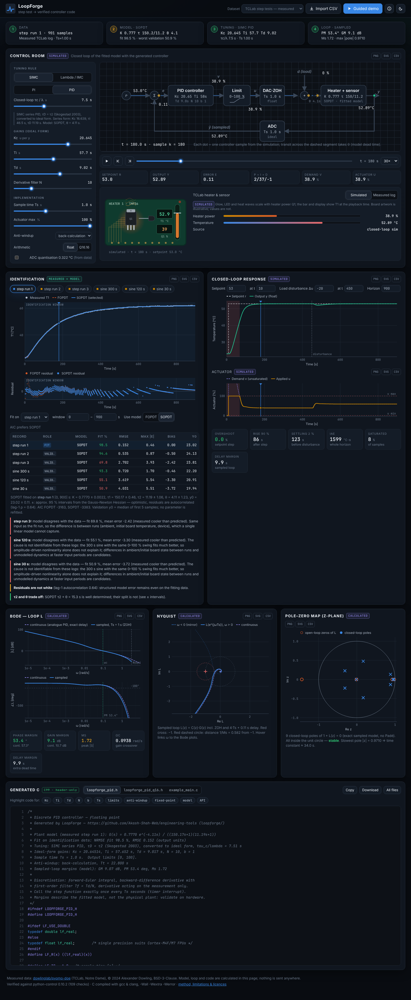
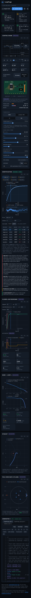

# LoopForge

**Turn a logged step-response CSV into tuned, verified, microcontroller-ready PI/PID C code, in one offline HTML file.**



*The GIF shows the real page state. It plays the simulated closed loop of the PID tuned on the measured TCLab model. With anti-windup off, the demand rises above 1000 % while the heater is pinned at 100 %. The second pass uses back-calculation. The last frames sweep the sample time.*

Open `index.html` in any modern browser; no server or network connection is needed. It loads a measured TCLab step test and runs the whole pipeline in under a second:

1. **Identify:** fit FOPDT and SOPDT models (with dead time) and report fit quality.
2. **Validate:** score the models on five other measured records that were not used for fitting, and show where they disagree.
3. **Tune:** apply the SIMC or lambda/IMC rules for PI or PID, with a slider for τc or λ and manual gain overrides.
4. **Simulate:** run the sampled closed loop with actuator saturation, anti-windup (none, clamping or back-calculation), sample time, optional ADC quantisation, and float or Q16.16 fixed-point arithmetic.
5. **Analyse:** compute the Bode, Nyquist and z-plane pole–zero plots of the *sampled* loop (ZOH and exact fractional delay), and the gain margin, phase margin, Ms and delay margin. The analogue loop is overlaid for comparison.
6. **Export:** produce header-only C99 controllers (`float`/`double` and Q16.16 fixed point) and an MCU example. Each plot can be saved as PNG, SVG or CSV.

| Desktop (dark) | Phone |
|---|---|
|  |  |

Light theme: [`docs/screenshots/desktop-light.png`](docs/screenshots/desktop-light.png)

---

## Demo instructions

- **Open** `loopforge/index.html`. It also works from GitHub Pages or `file://`.
- **Guided demo** (top right) has 10 steps. It walks through measured data, the fit/validation split, model disagreement, tuning, windup and anti-windup, the cost of a slow sample rate, poles, and the generated C. Use the arrow keys or Next/Back; Esc exits.
- **Control room:**
  - The console sliders set the rule, τc/λ, Kc, Ti, Td, N, Ts, the actuator limit, anti-windup and arithmetic.
  - The block diagram shows live signal values. Each moving dot is one controller sample from the simulation, and it takes θ (the model dead time) to cross the dashed delay segment.
  - The playback bar plays, pauses, steps one sample, scrubs and sets the speed.
  - The TCLab board can replay either the simulated loop or the measured log.
- **Hover** any plot for a crosshair and values. Time plots are linked to each other. Bode magnitude, Bode phase and Nyquist are linked through ω.
- **Code highlighting:** touching a slider highlights the C lines that implement that setting. You can also use the tag chips above the code.
- **Import CSV:** use the button or drag a file onto the page. Pick the time, input and output columns and enter the input value before t0. The first 70 % of the record is used for fitting and the last 30 % is held out.
- **URL options:** `?dataset=synthetic`, `?t=180` (paused at t = 180 s), `?speed=60`, `?demo` (start the tour).

Every visual is labelled **MEASURED**, **SIMULATED/CALCULATED**, **SYNTHETIC** or **USER DATA**. The PCB artwork is the only illustrative element, and its glow, readouts and bars are driven by the selected signal.

---

## Data and validation

See [`data/README.md`](data/README.md) for URLs, licence, access date, checksums and preprocessing.

- **Measured data:** six TCLab experiments from [`dowlinglab/pyomo-doe`](https://github.com/dowlinglab/pyomo-doe) (BSD-3, pinned to commit `d250c5b`). They are three 0→50 % heater steps and three 0–100 % sine tests, each 900 s at about 1 s sampling. `python3 data/fetch_data.py` downloads them and checks their SHA-256 checksums.
- **Blocked source:** the suggested APMonitor page (apmonitor.com/pdc … TCLabFOPDT) **could not be reached**, because the build environment's proxy returned HTTP 403. Its files were therefore not used.

### Identification on step run 1 (900 s, heater 0 → 50 %)

| Model | K [°C/%] | τ1 [s] | τ2 [s] | θ [s] | fit % | RMSE [°C] | max \|e\| | AIC |
|---|---|---|---|---|---|---|---|---|
| FOPDT | 0.7715 ± 0.002 | 151.6 ± 0.4 | — | 15.7 ± 0.4 | 98.3 | 0.172 | 0.81 | −3163 |
| SOPDT | 0.7770 ± 0.002 | 150.2 ± 0.5 | 11.2 ± 1.1 | 4.1 ± 1.2 | 98.5 | 0.152 | 0.46 | −3383 |

The ± values are approximate 95 % intervals from the Gauss–Newton Hessian. They are **optimistic**, because the residuals are autocorrelated (lag-1 ρ = 0.64–0.71). For comparison, the RMSE is close to the 0.32 °C sensor quantisation step. AIC prefers SOPDT. τ2 + θ ≈ 15.3 s is well determined, but the split between τ2 and θ is not. An independent scipy fit lands at τ2 = 11.6 s and θ = 3.5 s with practically the same SSE.

### Validation on data not used for fitting (SOPDT; parameters fixed, y0 = median of the first 5 samples)

| Record | Input | fit % | RMSE [°C] | max \|e\| | bias [°C] |
|---|---|---|---|---|---|
| step run 2 | same step | 94.6 | 0.54 | 0.87 | −0.50 |
| step run 3 | same step | **69.8** | 2.70 | 3.93 | **−2.42** |
| sine 300 s | 50 ± 50 %, 300 s period | 93.3 | 0.72 | 1.70 | −0.46 |
| sine 120 s | 50 ± 50 %, 120 s period | **55.1** | 3.62 | 5.54 | **−3.30** |
| sine 30 s | 50 ± 50 %, 30 s period | **50.9** | 4.03 | 5.51 | **−3.72** |

FOPDT gives similar numbers: 97.0, 72.8, 93.9, 57.5 and 53.1 % respectively.

**Where the model disagrees with the data:**

- **Run 3** has the same input as the fit run but ends about 2.4 °C cooler than predicted. Its temperature rise over the last minute is 35.1 °C against 39.0 °C for run 1, so its effective gain is about 10 % lower. This is run-to-run variation, from ambient conditions, initial board temperature or the device. A single linear model cannot capture it.
- **The 120 s and 30 s sine tests** are 3–4 °C cooler on average than predicted. The 300 s sine test has the same amplitude and fits at 93 %, so amplitude-driven nonlinearity alone does not explain the misfit. These two runs also started 2–3 °C colder than run 1. The data do not identify the cause, and LoopForge reports the misfit instead of explaining it away.
- **Residuals are not white** even on the fit run. Part of this is the 0.32 °C quantisation sawtooth, and part is structured error (lag-1 autocorrelation 0.64).
- **Run 2 starts at 24.1 °C**, which is probably not at equilibrium. The steady-state assumption used for validation is therefore only approximate for that run.

Read the stability margins with this in mind. Gain uncertainty of about ±10 % is real for this hardware. The default design (SIMC PID, τc = 7.5 s, Ts = 1 s) has a gain margin of 9.1 dB and a phase margin of 53°, which covers it.

---

## Method

| Stage | Implementation (`src/core.js`) |
|---|---|
| Plant | y = y0 + K e^(−θs)/((τ1 s+1)(τ2 s+1)) · (u − uPre). The logged input is a ZOH, and propagation is exact on any irregular grid, including the breakpoints of u(t−θ). |
| Fit | (K, y0) by linear least squares inside a Nelder–Mead search over (log τ1, log τ2, √θ), started from a 28×24 grid with restarts. |
| Fit metrics | NRMSE fit %, RMSE, MAE, max \|e\|, bias, R², AIC, residual lag-1 autocorrelation, approximate parameter intervals. |
| SIMC | PI: Kc = τ/(K(τc+θ)), Ti = min(τ, 4(τc+θ)). SOPDT PI uses Skogestad's half rule. SOPDT PID is series form with τD = τ2. FOPDT PID uses improved SIMC (τD = θ/3). All are converted to ideal form. |
| Lambda/IMC | PI: Kc = τ/(K(λ+θ)), Ti = τ. FOPDT PID: Rivera–Morari–Skogestad, with Padé(1) for the delay. SOPDT PID: Kc = (τ1+τ2)/(K(λ+θ)), Ti = τ1+τ2, Td = τ1τ2/(τ1+τ2). |
| Controller | u = Kc(b r − y) + I + D. I uses forward Euler, so I[k+1] = I[k] + Kc Ts/Ti e[k]. D is a backward difference with filter Tf = Td/N, acting on y only. Anti-windup is either back-calculation (Tt = √(Ti Td), or Ti for PI) or conditional integration. Initialisation is bumpless. |
| Sampled loop | The dead time is split as θ = d·Ts + θf, and the plant is sampled exactly with x[k+1] = Φx + Γ0 u[k−d] + Γ1 u[k−d−1] (modified z-transform). From this, L(z) = Cy(z) G(z). Poles are the roots of 1 + L(z), found with Aberth–Ehrlich and Newton polishing. |
| Margins | Computed on a 1600–6000-point log grid up to π/Ts, with unwrapped phase and bisection refinement of each crossover. Outputs are the minimum gain margin, minimum phase margin, Ms = max\|1/(1+L)\|, and delay margin PM/ωc. |
| Fixed point | Signals are Q16.16 in int32. The integrator is Q32.32 in int64. Each coefficient has its own fractional bit count (≤ 30), and shifts round half up. The JS mirror uses BigInt and is bit-exact with the C code. |

The generated code (`src/codegen.js`) uses the same coefficients as the simulator. Each line is tagged with the settings it implements (`kc ti td n b ts sat aw fixed model api`).

---

## Verification (what was actually run)

| Check | Command | Result |
|---|---|---|
| Core unit tests: analytic step responses, synthetic parameter recovery, tuning formulas, discrete = continuous at the samples, margins of k·e^(−θs)/s, closed loop = T(z), anti-windup, fixed vs float | `node --test tests/core.test.js` | 14/14 pass |
| **python-control / SciPy cross-check**, from independent re-implementations: forced-response fit with a scipy `least_squares` optimum, re-typed tuning formulas, `c2d` ZOH plant, `stability_margins`, `feedback().poles()`, Padé-12 analogue margins, expm-based nonlinear closed loop with saturation and anti-windup, linear closed loop via `forced_response` | `python3 tests/verify_python_control.py` | **109/109 pass**, python-control 0.10.2 (report: `tests/python_control_report.json`) |
| **Generated C compiled and run** with gcc 13 and clang (`-std=c99 -Wall -Wextra -Wpedantic -Werror -Wconversion -Wshadow -Wdouble-promotion`). Covers 2 types × 3 anti-windup modes × 2 sample times. Double build vs JS: < 1e-9. float32: < 0.05 %. **Q16.16: bit-exact** vs the JS mirror. Closed loop in C vs JS: < 1e-8. | `node --test tests/c_codegen.test.js` | 25/25 pass |
| Headless Chromium end-to-end, offline with all HTTP requests blocked: fit equals Node, hover linking, sliders update margins and code, anti-windup effect, Q16 mode, PNG/SVG/CSV export, CSV import (recovers the synthetic K = 1.25), synthetic labelling, the full guided demo, theme toggle, no console errors | `node tests/ui_check.js` | 25/25 pass |
| Layout at 1440×900 and 390×844 (phone), dark and light: screenshots inspected and horizontal overflow checked | `node tools/screenshots.js` | no overflow, no errors |

Notes from verification:

- `control.stability_margins` reported a slightly low stability margin in one case because it fell back to its FRD method. The Ms check therefore uses a dense 200k-point evaluation of Python's own L(z), and LoopForge agrees with it to better than 1e-4.
- The browser and Node fits agree to about 1e-8 relative. The different V8 builds round `Math.exp` slightly differently, which nudges the Nelder–Mead path.

Run everything:

```bash
cd loopforge
pip install control numpy scipy             # python-control 0.10.2 was used
node tools/build.js                          # rebuild index.html from src/
node --test tests/*.test.js                  # core + C (needs gcc and/or clang)
python3 tests/verify_python_control.py
node tests/ui_check.js                       # needs playwright + chromium
python3 data/fetch_data.py                   # optional: re-download data and verify checksums
```

---

## Limitations

- **Linear, single-operating-point models.** The validation table shows several °C of run-to-run and input-dependent error on real TCLab hardware. The margins describe the *model*. Commission on hardware with conservative settings first.
- **Assumed initial steady state.** Records are assumed to start at steady state, and the input before t0 must be supplied. Run 2 probably violates this.
- **Model structures.** Only FOPDT and overdamped SOPDT are offered, with no integrating or underdamped models. There is no weighting or outlier rejection in the fit.
- **Optimistic parameter intervals.** They ignore residual autocorrelation.
- **Simulator scope.** Sensor noise is not simulated. ADC quantisation is optional, with a 0.322 °C step inferred from the data. The simulated disturbance is a step at the plant input. Computation delay inside the sample is assumed to be zero.
- **Tuning rules apply to the fitted model.** Gains near the slider extremes can be unstable. The page flags this: the stage card shows UNSTABLE and the poles turn red.
- **Fixed-point assumptions.** The fixed-point code assumes arithmetic right shift of negative `int64_t`, which holds on GCC, Clang and the common Arm compilers. Signal range is ±32768 engineering units.
- **Pole–zero map uses the sampled loop.** The continuous-time loop with dead time has infinitely many poles. The pole–zero map is therefore drawn in the z-plane, where the delay is exactly z^−d.

## Files

```
loopforge/
  index.html                 single self-contained build (no external requests, no third-party code)
  src/core.js                maths (UMD: browser + Node)
  src/codegen.js             C generator
  src/ui/                    plot engine, app, style, HTML template
  tools/                     build, screenshots, GIF recorder, synthetic sample generator
  tests/                     node tests, C harness, python-control verification, UI check
  data/                      README, fetch script with checksums, measured samples (BSD-3), synthetic/
  docs/                      screenshots and GIF
```

No third-party libraries are bundled. The plotting, root finding and optimisation code is LoopForge's own (MIT). The embedded TCLab data keeps its BSD-3 notice, both in the HTML (in the comment and the "Data & licences" dialog) and in `data/samples/LICENSE-pyomo-doe.txt`.
